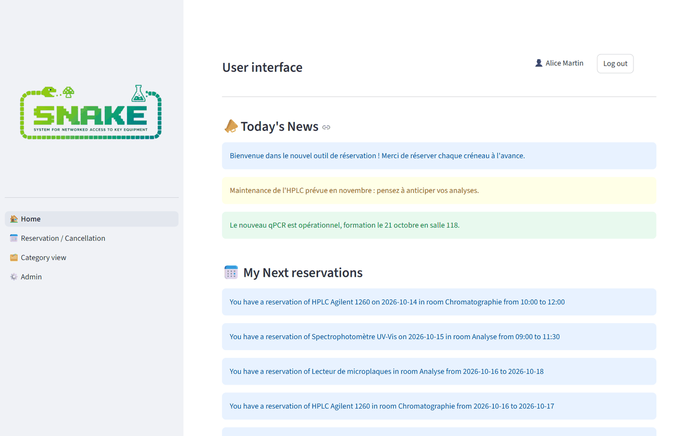
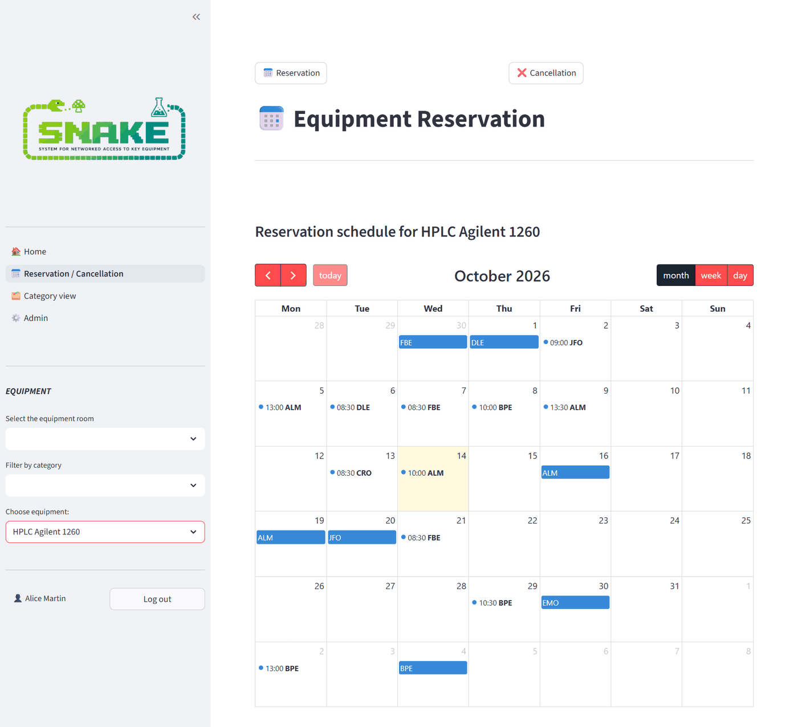
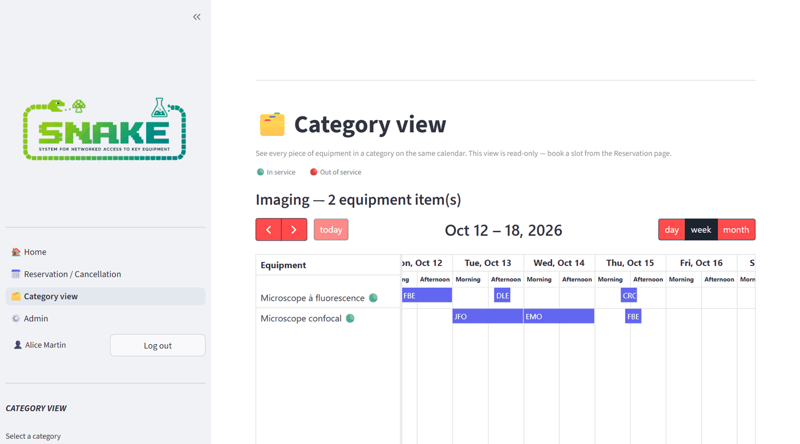
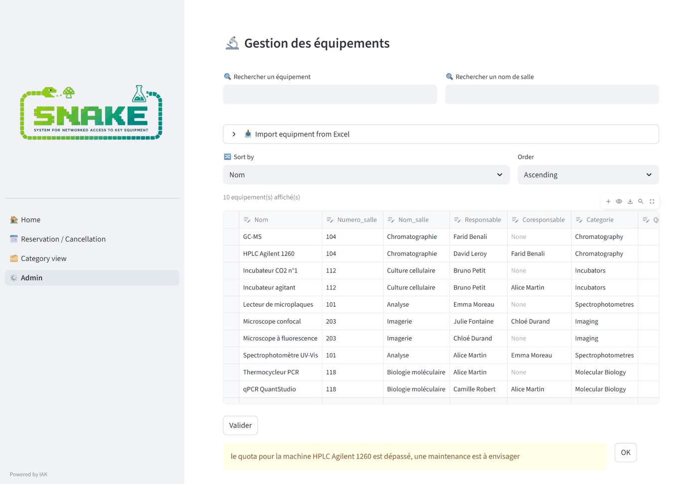
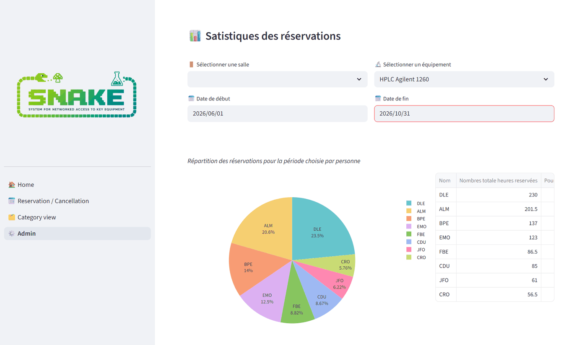

# 🐍 SNAKE-APP

**Application web de réservation d'équipements de laboratoire, développée avec Python, Streamlit et SQLite.**


Dans un laboratoire de recherche, les instruments sont partagés entre de
nombreuses personnes. Il devient vite difficile de savoir qui utilise quoi, à
quel moment, et quand chaque instrument devra passer en maintenance. SNAKE
remplace les feuilles papier et les tableurs partagés par une application web
unique :
- les utilisateurs réservent les équipements sur un calendrier ;
- les administrateurs gèrent les équipements, les utilisateurs et les droits d'accès ;
- tout le monde voit le planning du laboratoire en temps réel.

---

## 📸 Aperçu

> Les captures ci-dessous utilisent une base de **données fictives** : aucune
> donnée réelle du laboratoire n'est publiée.

**Page d'accueil** : actualités du laboratoire et prochaines réservations de l'utilisateur.



**Réservation** : planning d'un équipement, avec choix de la salle, de la catégorie et de l'instrument.



**Vue par catégorie** : tous les instruments d'une catégorie sur le même calendrier.



**Espace administrateur** : tableau éditable des équipements, avec alerte quand un quota de maintenance est dépassé.



**Statistiques** : répartition des heures de réservation par personne et par projet.



---

## ✨ Fonctionnalités

### Pour les utilisateurs du laboratoire
- **Connexion simplifiée par e-mail, sans mot de passe** (voir [Choix techniques](#-choix-techniques)). Les nouveaux comptes restent en attente jusqu'à leur validation par un administrateur.
- **Tableau de bord d'accueil** : actualités du laboratoire, mes prochaines réservations, anniversaires du jour et tableau des équipements filtrable par salle et par catégorie.
- **Réservation sur calendrier.** On peut réserver une journée entière ou choisir des horaires par pas de 30 minutes.
- **Contrôle automatique des conflits.** Une réservation est refusée si elle :
  - chevauche une réservation existante ;
  - chevauche une réservation sur une journée entière ou une maintenance planifiée ;
  - dépasse le nombre maximal de jours autorisé pour l'équipement.
- **Modification et annulation** de ses propres réservations.
- **Vue par catégorie.** Un calendrier affiche côte à côte tous les instruments d'une même catégorie.

### Pour les administrateurs
- **Gestion des utilisateurs.** Validation des nouveaux comptes et gestion des profils administrateurs.
- **Droits de réservation par équipement.** Certains instruments ne peuvent être réservés que par les utilisateurs que l'administrateur a autorisés, c'est-à-dire ceux qui ont été formés à leur utilisation.
- **Gestion des équipements** dans un tableau éditable :
  - salles, responsables et dates de maintenance ;
  - quotas d'utilisation, avec signalement automatique « maintenance nécessaire » quand un quota est dépassé ;
  - **import / export Excel**.
- **Gestion des projets et tableau d'annonces** pour communiquer avec tout le laboratoire.
- **Statistiques d'utilisation** par instrument et par période, avec des graphiques Plotly interactifs.
- **Historique complet** des réservations et des annulations.
- **Notifications par e-mail** via SMTP :
  - les administrateurs sont prévenus de chaque nouvelle inscription ;
  - les utilisateurs sont prévenus quand leur compte est validé.

### Planning public
- **Une page séparée, en lecture seule et conçue pour mobile** (`public_schedule.py`).
  Elle affiche le planning des équipements sans connexion et s'ouvre en scannant
  un **QR code** affiché dans les salles de manipulation (voir
  [Déploiement](#-déploiement)).

---

## 🌐 Déploiement

**L'application principale est hébergée sur le réseau interne du laboratoire.**
Elle n'est pas publiée sur internet : les données du laboratoire (utilisateurs,
réservations, projets) ne sortent pas du réseau.

**Le problème :** dans les salles de manipulation, il est impossible de se
connecter au réseau interne avec un téléphone. Les utilisateurs ne pouvaient
donc pas consulter le planning depuis l'endroit où ils en ont le plus besoin.

**La solution :** une page dédiée, `public_schedule.py`, qui tourne séparément
de l'application principale.
- Elle est accessible depuis un téléphone grâce à un **tunnel Tailscale**.
- On l'ouvre en scannant le **QR code** affiché dans les salles.
- Elle ne fait qu'afficher le planning : elle n'a ni connexion, ni réservation,
  ni accès en écriture à la base.
- Elle ne montre que le strict nécessaire : l'équipement, le créneau et
  l'utilisateur.

```
 Réseau interne du laboratoire                    Salles de manipulation
┌────────────────────────────────────┐
│ app.py + Pages/  (port 8501)       │
│   lecture / écriture               │
│               │                    │
│               ▼                    │
│          db/lab.db                 │
│               ▲                    │
│               │ lecture seule      │  tunnel     📱 Téléphone
│ public_schedule.py  (port 8502) ───┼─Tailscale──► (QR code)
└────────────────────────────────────┘
```

---

## 🛠️ Technologies

| Domaine | Outils |
|---|---|
| Langage | Python 3.13 |
| Framework web | Streamlit (application multi-pages) |
| Calendrier | streamlit-calendar (FullCalendar) |
| Base de données | SQLite |
| Données et graphiques | pandas, Plotly |
| Accès mobile | Tailscale (tunnel vers la page de planning public) |
| Autres | smtplib (e-mails), email-validator, openpyxl (Excel), qrcode |

---

## 🧠 Choix techniques

- **Connexion des utilisateurs par e-mail uniquement.** Nous voulions que les
  membres du laboratoire puissent réserver un équipement en quelques secondes,
  sans avoir à créer ni retenir de mot de passe. Ce choix est adapté au
  contexte :
  - le laboratoire est une petite équipe où tout le monde se fait confiance ;
  - l'application n'est accessible que depuis le réseau interne du laboratoire ;
  - chaque nouveau compte doit être validé par un administrateur avant de
    pouvoir réserver ;
  - pour les instruments sensibles, l'administrateur n'accorde le droit de
    réserver qu'aux personnes formées à leur utilisation ;
  - toutes les réservations et annulations sont enregistrées dans un
    historique : en cas de problème, l'origine est facile à identifier.

  Seul l'espace administrateur, qui permet de tout modifier, est protégé par un
  mot de passe.
- **Mot de passe administrateur haché.** Il est haché en SHA-256 avant d'être
  stocké en base de données.
- **Aucun secret dans le code.** Les identifiants SMTP et le mot de passe
  administrateur initial sont dans `.streamlit/secrets.toml`, un fichier
  exclu du dépôt git.
- **Page publique en lecture seule.** `public_schedule.py` ouvre SQLite en
  mode `ro` (read-only) : la page ne peut pas modifier la base, même en cas de
  bug. Elle masque aussi les noms de projets et les commentaires libres.
- **E-mails non bloquants.** Les fonctions d'envoi ne lèvent jamais
  d'exception. Si le SMTP est absent ou en panne, l'inscription et la
  validation des comptes continuent de fonctionner.
- **Sauvegardes automatiques.** La base est copiée dans `db/backups/` une fois
  par jour, et seules les 30 copies les plus récentes sont conservées.
- **Migrations du schéma.** Au lancement de l'application, `init_db()` crée
  les tables manquantes et ajoute les nouvelles colonnes : une base existante
  est mise à jour automatiquement.

---

## 📁 Structure du projet

```
├── app.py                      # Accueil : connexion, inscription, tableau de bord
├── Pages/
│   ├── 1_Reservation-Annulation.py   # Réservation, modification, annulation
│   ├── 2_Category_View.py            # Calendrier par catégorie d'équipements
│   └── 3_Admin.py                    # Espace administrateur
├── public_schedule.py          # Planning public en lecture seule (mobile)
├── db/database.py              # Schéma de la base et migrations
├── email_utils.py              # Notifications par e-mail (SMTP)
├── utils.py                    # Génération du QR code de la page publique
├── .streamlit/secrets.toml.example
└── requirements.txt
```

---

## 🚀 Installation

```bash
# 1. Cloner le dépôt
git clone https://github.com/akroutimen1-ui/SNAKE-APP.git
cd SNAKE-APP

# 2. Installer les dépendances (de préférence dans un environnement virtuel)
pip install -r requirements.txt

# 3. Configurer les secrets
cp .streamlit/secrets.toml.example .streamlit/secrets.toml
#    puis éditer .streamlit/secrets.toml : définir le mot de passe administrateur
#    (la section e-mail est facultative)

# 4. Lancer l'application
streamlit run app.py
```

La base de données SQLite (`db/lab.db`) est créée automatiquement au premier lancement.

Pour lancer aussi la page de planning public :

```bash
streamlit run public_schedule.py --server.port 8502
```

---

## 👤 Auteur

**Imen Akrout**
